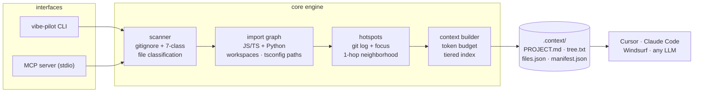

# vibe-pilot

[](https://www.npmjs.com/package/vibe-pilot)
[](./LICENSE)
[](./package.json)

**The context optimizer for AI engineers.** Prunes boilerplate, compresses the dependency tree, and generates a focused `.context/` brief — *before* you feed your codebase to Cursor, Claude Code, or Windsurf.

```
300.6M raw tokens  →  877k brief tokens  (−99.7%)     measured across 21 real repos
```

## The problem

Modern agents are context-limited and context-expensive. Drop a real repository into Cursor or Claude Code and you get:

- **token burn** — lockfiles, snapshots, fixtures, and vendored code you pay for on every turn;
- **noise** — 128k files across 21 popular repos average **14M tokens** of raw text, while the task usually touches 20–50 files;
- **no priorities** — the agent can't tell the file you edited yesterday from a 3-year-old fixture.

vibe-pilot fixes the input, not the model: it scans your repo, builds the JS/TS + Python import graph, reads git hotspots, and emits a compact `.context/` package your agent reads first.

## 60-second quick start

```bash
npm install -g vibe-pilot

cd your-project

# 1. see what your repo costs an agent (read-only)
vibe-pilot scan

# 2. generate the .context/ briefing package
vibe-pilot context

# 3. point your agent at it — e.g. add to your prompt:
#    "Read .context/PROJECT.md first, use .context/files.json as the file index."
```

`vibe-pilot init` writes a `vibe-pilot.config.json` and adds `.context/` to your `.gitignore` in one step.

## What you get

`.context/` contains exactly four files:

| file | what it is | who reads it |
| --- | --- | --- |
| `PROJECT.md` | AI briefing: what the project is, entry points, hot files, focus area, dead-code candidates, stats table | humans + agents (start here) |
| `tree.txt` | pruned source tree with `▲` hot · `✦` focus · `~` cold annotations and per-directory token costs | agents doing discovery |
| `files.json` | tiered machine index of every file: class, tokens, hot commits, focus score, import counts | agents doing lookups |
| `manifest.json` | generation manifest + stats (reproducibility, CI checks) | tooling |

Nothing else. No lockfiles, no fixtures, no `node_modules`, no generated bundles — gitignore-aware, with built-in boilerplate rules and a 512KB oversize guard.

## How it works



1. **scan** — walk the repo honoring `.gitignore` plus built-in boilerplate rules (`node_modules/`, `dist/`, `__pycache__/`, lockfiles, `*.min.*`, …), classify every file into 7 classes, estimate raw token cost.
2. **graph** — parse JS/TS and Python imports, resolve relative paths, tsconfig path aliases, and monorepo workspace packages (`@scope/pkg`), detect entry points (package.json `main`/`exports`/`bin`, with `dist/`→`src/` fallback), then run a reachability analysis: anything unreachable is a dead-code candidate.
3. **hot** — `git log --name-only` over the last 30 days finds hotspots; a focus query boosts matches **and their 1-hop import neighbors** at half weight.
4. **context** — assemble the four artifacts under a token budget (balanced: 60k), trimming the tree and the index from the bottom until it fits.

Full-resolution diagram: [`docs/assets/architecture.svg`](docs/assets/architecture.svg).

## CLI reference

```
vibe-pilot scan [root]      read-only cost report: classes, tokens, entries, hot, cold
vibe-pilot context [root]   generate .context/ (the main command)
vibe-pilot focus <query…>   rank files around a topic, incl. 1-hop neighbors
vibe-pilot init [root]      write vibe-pilot.config.json + gitignore .context/
vibe-pilot mcp              start the MCP server on stdio

options: --json · -p/--profile conservative|balanced|aggressive
         --focus <query> · --hot-days <n> · --no-write · --out <dir>
```

Profiles:

| profile | file cap | classes kept | hot window | token budget |
| --- | ---: | --- | ---: | ---: |
| `conservative` | 1MB | source, test, config, docs, assets, data | 60d | 150k |
| `balanced` *(default)* | 512KB | source, test, config, data | 30d | 60k |
| `aggressive` | 256KB | source, test | 14d | 25k |

## Use it as an MCP server

One binary, four tools (`vibe_pilot_scan`, `get_context`, `focus`, `list_files`). Results are truncated to ~24k characters so a tool call can never blow the context window, and diagnostics go to stderr — stdout stays a clean JSON-RPC stream.

**Claude Code**

```bash
claude mcp add vibe-pilot -- npx -y vibe-pilot mcp
```

or in `.mcp.json` / `claude_desktop_config.json`:

```json
{
  "mcpServers": {
    "vibe-pilot": {
      "command": "npx",
      "args": ["-y", "vibe-pilot", "mcp"]
    }
  }
}
```

**Cursor** — `~/.cursor/mcp.json`, same JSON block as above.

**Windsurf** — `~/.codeium/windsurf/mcp_config.json`, same JSON block as above.

Then ask your agent things like *"scan this repo and tell me where the dead code is"* or *"get the context brief for the payment module"* and it will call vibe-pilot itself.

## Benchmark

21 real repositories, shallow clones, `balanced` profile, single run on a laptop — raw text cost vs. the shipped `.context/` brief. Raw data: [`docs/benchmark.json`](docs/benchmark.json).

| repo | files | raw tokens | brief tokens | reduction | time |
| --- | ---: | ---: | ---: | ---: | ---: |
| [microsoft/vscode](https://github.com/microsoft/vscode) | 20,795 | 88.2M | 54.2k | −99.9% | 6090ms |
| [facebook/react](https://github.com/facebook/react) | 7,274 | 10.8M | 49.1k | −99.5% | 764ms |
| [vercel/next.js](https://github.com/vercel/next.js) | 32,149 | 27.6M | 56.9k | −99.8% | 5663ms |
| [vuejs/core](https://github.com/vuejs/core) | 704 | 1.7M | 33.3k | −98.1% | 76ms |
| [angular/angular](https://github.com/angular/angular) | 11,706 | 31.4M | 52.0k | −99.8% | 1364ms |
| [langfuse/langfuse](https://github.com/langfuse/langfuse) | 8,030 | 16.1M | 51.0k | −99.7% | 1225ms |
| [prisma/prisma](https://github.com/prisma/prisma) | 12,419 | 25.3M | 52.0k | −99.8% | 2050ms |
| [vitejs/vite](https://github.com/vitejs/vite) | 2,980 | 4.6M | 54.1k | −98.8% | 280ms |
| [ant-design/ant-design](https://github.com/ant-design/ant-design) | 5,066 | 15.9M | 54.0k | −99.7% | 436ms |
| [tailwindlabs/tailwindcss](https://github.com/tailwindlabs/tailwindcss) | 563 | 1.5M | 27.5k | −98.2% | 55ms |
| [axios/axios](https://github.com/axios/axios) | 532 | 1.3M | 20.7k | −98.4% | 34ms |
| [lodash/lodash](https://github.com/lodash/lodash) | 65 | 554.2k | 3.6k | −99.3% | 9ms |
| [expressjs/express](https://github.com/expressjs/express) | 216 | 184.0k | 10.4k | −94.3% | 14ms |
| [electron/electron](https://github.com/electron/electron) | 3,081 | 7.9M | 56.1k | −99.3% | 278ms |
| [huggingface/transformers](https://github.com/huggingface/transformers) | 6,764 | 25.0M | 56.4k | −99.8% | 1092ms |
| [langchain-ai/langchain](https://github.com/langchain-ai/langchain) | 3,278 | 12.0M | 57.4k | −99.5% | 474ms |
| [django/django](https://github.com/django/django) | 7,029 | 12.6M | 50.2k | −99.6% | 519ms |
| [fastapi/fastapi](https://github.com/fastapi/fastapi) | 3,243 | 9.0M | 58.3k | −99.4% | 137ms |
| [psf/requests](https://github.com/psf/requests) | 128 | 1.1M | 6.0k | −99.5% | 11ms |
| [scikit-learn/scikit-learn](https://github.com/scikit-learn/scikit-learn) | 1,869 | 6.3M | 55.2k | −99.1% | 179ms |
| [modelcontextprotocol/servers](https://github.com/modelcontextprotocol/servers) | 414 | 1.5M | 18.6k | −98.8% | 70ms |
| **21 repos total** | **128,305** | **300.6M** | **877.1k** | **−99.7%** | 9ms–6.1s (median 280ms) |

Token counts are `bytes/4` estimates for code and `bytes/3` for dense formats (JSON/YAML/lockfiles) — a deliberately conservative heuristic, not a tokenizer clone.

## Development

```bash
git clone https://github.com/renniyy/vibe-pilot && cd vibe-pilot
npm install
npm test      # 12 tests in 7 suites, incl. a full MCP stdio JSON-RPC handshake
npm run bench # re-run the 21-repo benchmark (clones into repos/, ~1.5GB)
```

## Roadmap

- **v0.2** — `--watch` mode; Go and Rust import graphs; GitHub Action that commits a refreshed `.context/` on PRs; per-workspace profiles for monorepos.
- **ideas** — blame-weighted focus; docstring extraction into PROJECT.md; `get_context` streaming for huge monorepos.

## License

[MIT](./LICENSE) © renniyy

<!-- vibe-pilot: generated .context/ brief keeps agents focused -->
